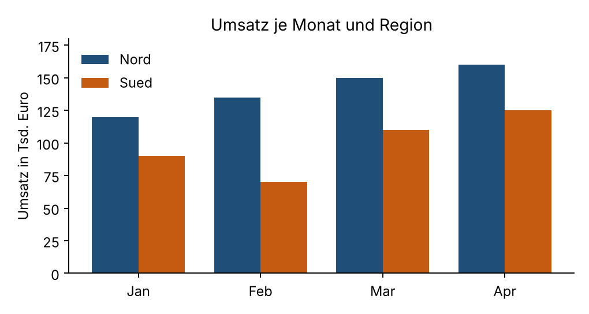

# Modul 6 - Daten, Datenbanken und Analytik-Grundlagen

> **Hinweis zu diesem Kapitel:** Das ist das Kapitel des Skripts „CompTIA Tech+ / ITF+ (FC0-U71): Lernskript in Modulen“, aus der LaTeX-Quelle in Markdown umgewandelt (Text und Listings unverändert, Boxen als Zitatblöcke, Aufgaben und Lösungen als nummerierte Listen). Laut Skript wurden die Python-Beispiele bei der Erstellung im Arbeitsbereich ausgeführt, die gezeigten Ausgaben stammen aus diesen Läufen; Windows- und PowerShell-Befehle wurden nicht ausgeführt. Für dieses Repository wurden die Listings **nicht erneut ausgeführt**. Prüfungsdetails, Produktnamen und Versionen ändern sich; maßgeblich sind die aktuellen Prüfungsziele (Exam Objectives) von CompTIA. Übersicht zum Modul: [README](README.md).

**Dauer:** 7 h

**Priorität:** 1 (höchste)

| Nr. | Lerneinheit                          | Dauer (h) | Prio |
|----:|:-------------------------------------|----------:|-----:|
| 6.1 | Datentypen und Formate               |      0,75 |    1 |
| 6.2 | Datenlebenszyklus                    |      0,75 |    2 |
| 6.3 | Relationale Grundbegriffe            |         1 |    1 |
| 6.4 | SQL-Grundlagen                       |         1 |    1 |
| 6.5 | Datenqualität                        |      0,75 |    1 |
| 6.6 | Datensicherung und Wiederherstellung |      0,75 |    2 |
| 6.7 | Datenschutz im Datenumgang           |      0,75 |    1 |
| 6.8 | Einfache Analytik und Visualisierung |      1,25 |    2 |
|     | **Summe**                            |     **7** |      |

Daten sind der Rohstoff fast jeder IT-Anwendung: Kundenlisten, Messwerte, Bestellungen, Protokolle, Fotos. Dieses Modul zeigt, wie Daten dargestellt werden (Typen und Formate), welchen Weg sie von der Erfassung bis zur Löschung nehmen, wie man sie in relationalen Datenbanken ordnet und mit SQL abfragt, woran man gute von schlechter Datenqualität unterscheidet, wie man sie sichert und schützt und wie man aus Zahlen verständliche Aussagen macht. Fast alle Beispiele laufen mit Python und der in Python eingebauten Datenbank SQLite; man braucht also keine Datenbank-Installation. Die Domäne “Daten und Datenbankgrundlagen” macht 13 Prozent der Prüfung aus; Datenschutz und Sicherung berühren außerdem die Sicherheitsdomäne.

## 6.1 Datentypen und Formate

Ein *Datentyp* legt fest, welche Art von Wert eine Angabe darstellt und was man damit tun darf. Die wichtigsten Grundtypen sind *Ganzzahlen* (englisch *Integer*, etwa 42), *Gleitkommazahlen* (*Float*, etwa 3,14), *Text* (*String*), *Wahrheitswerte* (*Boolean*, nur wahr oder falsch), *Datum und Uhrzeit* (*Date*, *Time*, *Timestamp*) und der Sonderfall *NULL* (in Python `None`), der “kein Wert” oder “unbekannt” bedeutet und ausdrücklich nicht dasselbe ist wie die Zahl 0 oder ein leerer Text. Der Typ bestimmt, wie viel Speicher ein Wert braucht und welche Operationen sinnvoll sind: Man kann zwei Zahlen addieren, aber bei Texten bedeutet “Addition” das Aneinanderhängen, und “12” plus “3” ergibt als Text “123”.

Ein klassischer Stolperstein sind Gleitkommazahlen. Computer speichern sie binär, und viele Dezimalbrüche wie 0,1 lassen sich im Binärsystem nicht exakt darstellen, genauso wie sich ein Drittel im Dezimalsystem nicht exakt schreiben lässt. Deshalb ergibt $0{,}1 + 0{,}2$ in den meisten Programmiersprachen nicht genau 0,3. Für Geldbeträge verwendet man daher Festkomma- oder Dezimaltypen (in Datenbanken `DECIMAL`, in Python das Modul `decimal`) oder rechnet in der kleinsten Einheit (Cent) mit Ganzzahlen.

Auch Text ist weniger einfach, als er aussieht. Jedes Zeichen muss in Bytes übersetzt werden, und die Vorschrift dafür heißt *Zeichenkodierung*. Alte Kodierungen wie ASCII kennen nur 128 Zeichen ohne Umlaute; *Latin-1* deckt westeuropäische Zeichen mit einem Byte je Zeichen ab; *Unicode* definiert Zeichen aller Schriftsysteme, und *UTF-8* ist die heute fast überall verwendete Kodierung dafür: Es verwendet für ASCII-Zeichen ein Byte und für Umlaute zwei oder mehr. Wird Text mit der einen Kodierung geschrieben und mit einer anderen gelesen, entstehen die bekannten Zeichenfehler, zum Beispiel erscheint “Müller” als “Müller”.

Dieselben Daten lassen sich in unterschiedlichen *Dateiformaten* austauschen. *CSV* (Comma-Separated Values) ist eine Textdatei, in der jede Zeile einen Datensatz bildet und die Felder durch ein Trennzeichen getrennt sind; sie ist einfach, kompakt und von Tabellenkalkulationen lesbar, kennt aber keine Datentypen (alles ist Text) und keine Verschachtelung. Enthält ein Wert das Trennzeichen, muss er in Anführungszeichen stehen. In deutschen Excel-Installationen ist das Trennzeichen oft ein Semikolon, weil das Komma als Dezimalzeichen dient. *JSON* (JavaScript Object Notation) speichert verschachtelte Daten aus Objekten (Schlüssel-Wert-Paare in geschweiften Klammern) und Listen (eckige Klammern); es kennt Zahlen, Text, Wahrheitswerte und `null` und ist das Standardformat für Webschnittstellen. *XML* (Extensible Markup Language) beschreibt Daten mit Tags in spitzen Klammern, ist ausführlicher, aber sehr genau beschreibbar (Schemata) und findet sich in Konfigurationsdateien, Office-Dokumenten und älteren Schnittstellen. Dazu kommen binäre Formate wie Excel-Dateien, Bilder oder Datenbankdateien. Die Wahl des Formats hängt vom Zweck ab: Für eine einfache Tabelle genügt CSV, für Schnittstellen zwischen Programmen eignet sich JSON, für dokumentierte, streng geprüfte Austauschformate XML.

Das folgende Programm zeigt die Typen, den Gleitkommafehler und seine Lösung, den Kodierungsfehler und denselben Datensatz in den drei Formaten. Es benötigt nur die Standardbibliothek.

```python
import csv, io, json
import xml.etree.ElementTree as ET
from decimal import Decimal
from datetime import date

print(type(42).__name__, type(3.14).__name__, type("Text").__name__,
      type(True).__name__, type(date(2026, 10, 24)).__name__, type(None).__name__)
print(0.1 + 0.2, 0.1 + 0.2 == 0.3)
print(Decimal("0.1") + Decimal("0.2"), Decimal("0.1") + Decimal("0.2") == Decimal("0.3"))

text = "Müller"
utf8 = text.encode("utf-8")
print(len(text), "Zeichen,", len(utf8), "Byte in UTF-8;", len(text.encode("latin-1")), "Byte in Latin-1")
print("falsch gelesen:", utf8.decode("latin-1"))

datensatz = {"id": 7, "name": "Anna Berger", "ort": "Graz, Steiermark", "aktiv": True}
puffer = io.StringIO()
w = csv.DictWriter(puffer, fieldnames=datensatz.keys())
w.writeheader(); w.writerow(datensatz)
csv_text = puffer.getvalue()
print(csv_text)
json_text = json.dumps(datensatz, ensure_ascii=False)
print(json_text)
wurzel = ET.Element("person", id="7")
for k in ("name", "ort", "aktiv"):
    ET.SubElement(wurzel, k).text = str(datensatz[k])
xml_text = ET.tostring(wurzel, encoding="unicode")
print(xml_text)
print(len(csv_text), len(json_text), len(xml_text))
print(json.loads(json_text)["aktiv"] is True, list(csv.DictReader(io.StringIO(csv_text)))[0]["aktiv"])
```

Die erste Zeile gibt die Typnamen aus: `int float str bool date NoneType`. Die Gleitkomma-Addition liefert `0.30000000000000004` und der Vergleich mit 0,3 ergibt `False`; mit dem `Decimal`-Typ, der Zahlen als Dezimalziffern speichert, erhält man genau `0.3` und `True`. Der Kodierungsteil zeigt, dass das Wort “Müller” sechs Zeichen, aber sieben Byte in UTF-8 hat (das “ü” braucht zwei), in Latin-1 dagegen nur sechs Byte. Liest man die UTF-8-Bytes fälschlich als Latin-1, kommt `Müller` heraus. Danach wird derselbe Datensatz dreifach geschrieben. CSV setzt den Ort “Graz, Steiermark” wegen des Kommas automatisch in Anführungszeichen. JSON erhält den Wahrheitswert als echten Typ (`true`); mit `ensure_ascii=False` bleiben Umlaute erhalten. XML erhält jeden Wert als Element mit Text, auch den Wahrheitswert, der hier als Wort “True” landet, also Text ist. Die Längen 58, 74 und 94 Zeichen zeigen, dass CSV am kompaktesten und XML am ausführlichsten ist. Die letzte Zeile verdeutlicht den Typunterschied: JSON liefert beim Zurücklesen ein echtes `True`, CSV nur den Text “True”.

### Typische Fehler.

Falsch ist, Geldbeträge in Gleitkommazahlen zu rechnen: Bei vielen Rechnungspositionen summieren sich die kleinen Fehler. Richtig ist, mit `Decimal` oder in Cent zu rechnen. Falsch ist auch, Telefon- oder Postleitzahlen als Zahl zu speichern: Aus `0043 316 ...` wird sonst eine Zahl ohne führende Nullen. Ein häufiger Fehler beim Datenaustausch ist die Kodierung: Eine CSV-Datei, die in Excel mit der falschen Zeichenkodierung geöffnet wird, zeigt Umlaute als Kauderwelsch. Auch das Datumsformat ist fehleranfällig: “03.04.2026” bedeutet in Österreich den 3. April, in den USA (“03/04/2026”) den 4. März. Das internationale Format `2026-04-03` (ISO 8601) ist eindeutig.

### Praxisbezug.

Beim Export einer Kundenliste aus einem Verwaltungsprogramm in Excel entscheidet die Wahl von Trennzeichen und Kodierung, ob die Datei richtig aufgeht. Webdienste liefern Daten fast immer als JSON, und Konfigurationsdateien vieler Programme sind in XML oder JSON geschrieben.

> **Merke**
>
> Typen bestimmen, was man mit einem Wert tun darf. Gleitkommazahlen sind ungenau, Geld rechnet man mit Dezimaltypen. UTF-8 ist die Standardkodierung. CSV = einfach, kein Typ; JSON = verschachtelt, Webstandard; XML = ausführlich, streng beschreibbar.

## 6.2 Datenlebenszyklus

Daten haben ein Leben: Sie entstehen, werden gespeichert, genutzt, gegebenenfalls weitergegeben, irgendwann nicht mehr gebraucht und schließlich gelöscht. Diese Abfolge heißt *Datenlebenszyklus* (*Data Lifecycle*). Wer ihn kennt, kann an jeder Stelle gezielt Regeln für Qualität, Sicherheit und Datenschutz festlegen.

Die Phasen lauten meist: *Erfassung* (Daten entstehen oder werden erhoben, zum Beispiel durch ein Formular, einen Sensor oder den Import aus einem anderen System), *Speicherung* (die Daten werden in Dateien oder Datenbanken abgelegt und gegen Verlust gesichert), *Nutzung und Verarbeitung* (Abfragen, Berechnungen, Auswertungen), *Weitergabe* (Freigabe an Kolleginnen, Kunden, Behörden oder Dienstleister), *Archivierung* (Daten werden nicht mehr täglich benötigt, müssen aber aufbewahrt werden, zum Beispiel aus rechtlichen Gründen) und *Löschung* (die Daten werden unwiederbringlich vernichtet, wenn kein Grund zur Aufbewahrung mehr besteht). Auf jeder Stufe sind andere Fragen wichtig: Bei der Erfassung, ob nur die nötigen Daten verlangt werden und ob sie stimmen; bei der Speicherung, wer Zugriff hat und ob verschlüsselt wird; bei der Nutzung, ob der Zweck passt; bei der Archivierung, wie lange und wo; bei der Löschung, ob sie wirklich vollständig geschieht, auch in Sicherungskopien.

Für diese Fragen braucht es klare Zuständigkeiten. Der *Dateneigentümer* (*Data Owner*) trägt die fachliche Verantwortung für einen Datenbestand und entscheidet über Zweck, Zugriff und Aufbewahrung. Ein *Datenverwalter* (*Data Steward*) kümmert sich um die Qualität und um die Einhaltung der Regeln, und die *IT* betreibt als technischer Verwalter (*Custodian*) die Systeme, auf denen die Daten liegen. Eine *Aufbewahrungsrichtlinie* legt fest, wie lange welche Datenarten aufgehoben werden. Gesetzliche Fristen setzen Mindestdauern, Datenschutzregeln setzen Höchstdauern: Daten, die nicht mehr nötig sind, sind zu löschen (Abschnitt 6.7 und Modul 11).

> **Ergänzung aus der Nachrecherche**
>
> Nach der Übersicht der Wirtschaftskammer Österreich (abgerufen) sind Bücher, Aufzeichnungen, Belege und für die Abgabenerhebung bedeutsame Geschäftspapiere grundsätzlich sieben Jahre aufzubewahren; die Frist beginnt mit dem Ende des Kalenderjahres der letzten Eintragung, und solange ein Verfahren läuft, gilt die Pflicht weiter. Für Grundstücke und bestimmte Fälle gelten längere Fristen (zum Beispiel 22 Jahre). Elektronisch gespeicherte Unterlagen müssen vollständig und unverändert verfügbar bleiben. Das ist ein Beispiel dafür, dass Löschfristen im Datenlebenszyklus nicht beliebig gewählt werden dürfen. Die Angaben sind eine allgemeine Orientierung und keine Rechtsberatung; Fristen in anderen Ländern und für andere Dokumentarten weichen ab.

Das folgende Beispiel setzt eine einfache Aufbewahrungsrichtlinie in ein Programm um. Dokumente, die länger als ein Jahr nicht genutzt wurden, werden archiviert; archivierte Dokumente werden nach sieben Jahren zur Löschung freigegeben. Das Programm bekommt das heutige Datum als Parameter, damit sich die Ergebnisse nachvollziehen lassen.

```python
from datetime import date

AUFBEWAHRUNG_AKTIV_TAGE = 365
AUFBEWAHRUNG_ARCHIV_JAHRE = 7

def lebenszyklus(letzte_nutzung, heute, archiviert_am=None):
    if archiviert_am is None:
        if (heute - letzte_nutzung).days > AUFBEWAHRUNG_AKTIV_TAGE:
            return "archivieren"
        return "aktiv nutzen"
    ablauf = archiviert_am.replace(year=archiviert_am.year + AUFBEWAHRUNG_ARCHIV_JAHRE)
    if heute >= ablauf:
        return f"loeschen (Frist seit {ablauf.isoformat()} abgelaufen)"
    return f"archiviert bis {ablauf.isoformat()}"

heute = date(2026, 10, 24)
faelle = [
    ("Angebot 2026", date(2026, 9, 1), None),
    ("Rechnung 2024", date(2024, 12, 2), None),
    ("Vertrag 2018", date(2018, 5, 3), date(2019, 1, 15)),
    ("Bewerbung 2016", date(2016, 3, 9), date(2018, 6, 30)),
    ("Lieferschein 2022", date(2022, 2, 1), date(2022, 12, 31)),
]
for name, nutzung, archiv in faelle:
    print(f"{name:18} -> {lebenszyklus(nutzung, heute, archiv)}")
```

Die beiden Konstanten legen die Fristen fest, sodass man sie an einer Stelle ändern kann. Die Funktion `lebenszyklus` unterscheidet zwei Fälle. Ist das Dokument noch nicht archiviert (`archiviert_am is None`), vergleicht sie die Tage seit der letzten Nutzung mit der Aktivfrist und gibt “archivieren” oder “aktiv nutzen” zurück. Ist es archiviert, berechnet sie den Ablauf mit `replace(year=...)`, indem sie sieben Jahre zum Archivierungsdatum addiert, und gibt entweder “loeschen” oder das Ende der Frist aus. Die Ausgabe: Das Angebot von 2026 wird aktiv genutzt, die Rechnung von 2024 archiviert, der Vertrag (archiviert Januar 2019, Frist seit 15.01.2026) und die Bewerbung (Frist seit 30.06.2025) sind zur Löschung freigegeben, und der Lieferschein bleibt bis 31.12.2029 archiviert. Eine echte Richtlinie unterscheidet nach Dokumentenart, hier ist sie vereinfacht.

### Typische Fehler.

Falsch ist die Haltung “Speicher ist billig, wir löschen nie”: Wer ohne Notwendigkeit Daten aufbewahrt, hat größere Schäden bei Datenpannen und verstößt unter Umständen gegen Löschpflichten. Ebenso falsch ist das Gegenteil, Daten zu früh zu löschen und damit Aufbewahrungsfristen zu verletzen. Typisch ist außerdem, Kopien zu vergessen: Die Löschung in der Hauptdatenbank hilft nichts, wenn dieselben Daten in Exporten, Backups und E-Mails weiterleben.

### Praxisbezug.

Beim Ausscheiden einer Mitarbeiterin entscheidet der Datenlebenszyklus, was mit ihrem Postfach und ihrem Laufwerk passiert: Fachliche Inhalte werden übergeben oder archiviert, persönliche Daten nach Frist gelöscht. Bewerbungsunterlagen abgelehnter Kandidaten werden nach kurzer Frist gelöscht, Rechnungen nach den gesetzlichen Fristen.

## 6.3 Relationale Grundbegriffe

Eine *Datenbank* ist ein organisierter Datenbestand, der von einem *Datenbankmanagementsystem* (DBMS) verwaltet wird. Das System sorgt dafür, dass mehrere Benutzer gleichzeitig lesen und schreiben können, dass Daten konsistent bleiben und dass Abfragen schnell gehen. Das am weitesten verbreitete Modell ist die *relationale Datenbank*: Daten liegen in Tabellen, die sich über gemeinsame Werte miteinander verknüpfen lassen. Bekannte Systeme sind PostgreSQL, MySQL, Microsoft SQL Server, Oracle und das besonders leichtgewichtige SQLite. Daneben gibt es *NoSQL*-Datenbanken, die Daten als Dokumente, Schlüssel-Wert-Paare oder Graphen speichern und dort sinnvoll sind, wo das Schema stark variiert oder riesige Datenmengen zu verteilen sind.

Eine *Tabelle* (*Table*, in der Theorie “Relation”) besteht aus *Spalten* (*Columns*, *Felder*, *Attribute*), die jeweils einen Namen und einen Datentyp haben, und aus *Zeilen* (*Rows*, *Datensätze*, *Records*), die jeweils einen Gegenstand beschreiben, zum Beispiel einen Kunden. Jede Zeile muss eindeutig identifizierbar sein. Dafür dient der *Primärschlüssel* (*Primary Key*): eine Spalte oder Spaltenkombination, deren Wert in jeder Zeile anders ist und nie leer sein darf, meist eine fortlaufende Nummer wie die Kundennummer. Ein *Fremdschlüssel* (*Foreign Key*) ist eine Spalte, die auf den Primärschlüssel einer anderen Tabelle verweist; so verknüpft eine Bestellung ihren Kunden über die Kundennummer, ohne dessen Namen und Adresse zu wiederholen. Das Datenbanksystem kann die *referenzielle Integrität* erzwingen: Eine Bestellung mit nicht existierendem Kunden wird abgelehnt.

Beziehungen zwischen Tabellen gibt es in drei Arten. Bei *1:1* gehört zu jedem Datensatz genau ein Datensatz der anderen Tabelle (selten, etwa Mitarbeiter und Gehaltsdaten). Bei *1:n* gehören zu einem Datensatz viele andere (ein Kunde hat viele Bestellungen); das ist der häufigste Fall und wird mit einem Fremdschlüssel auf der “n-Seite” umgesetzt. Bei *n:m* können beide Seiten mehrfach vorkommen (eine Bestellung enthält viele Produkte, ein Produkt steht in vielen Bestellungen) und brauchen eine dritte, *Verbindungstabelle* mit zwei Fremdschlüsseln. Der Entwurf wird oft in einem *Entity-Relationship-Diagramm* (ER-Diagramm) dargestellt, mit Kästen für Tabellen und Linien für Beziehungen.

Ein Grundgedanke des Entwurfs ist die *Normalisierung*: Jede Information soll an genau einer Stelle gespeichert werden. Steht der Wohnort eines Kunden in jeder seiner Bestellungen, muss er bei einem Umzug überall geändert werden; vergisst man eine Zeile, widersprechen sich die Daten (*Änderungsanomalie*). Aufgeteilt in Kunden- und Bestelltabelle steht der Ort nur einmal. Zusätzlich lassen sich *Einschränkungen* (*Constraints*) festlegen: `NOT NULL` verbietet leere Werte, `UNIQUE` verbietet Doppelte, `CHECK` prüft eine Bedingung wie “Betrag nicht negativ”. Ein *Index* beschleunigt Suchen, ähnlich dem Stichwortverzeichnis eines Buches, kostet aber Speicher und Schreibzeit.

Das folgende Beispiel baut ein kleines Datenmodell mit SQLite und prüft, wie die Datenbank fehlerhafte Eingaben ablehnt. Die Tabelle `kunde` hat einen Primärschlüssel, einen Pflichtnamen und eine eindeutige E-Mail; die Tabelle `bestellung` verweist per Fremdschlüssel auf den Kunden und verlangt einen nicht negativen Betrag.

```python
import sqlite3

db = sqlite3.connect(":memory:")
db.execute("PRAGMA foreign_keys = ON")
db.executescript("""
CREATE TABLE kunde (
    kunde_id INTEGER PRIMARY KEY,
    name     TEXT NOT NULL,
    ort      TEXT,
    email    TEXT UNIQUE
);
CREATE TABLE bestellung (
    bestell_id INTEGER PRIMARY KEY,
    kunde_id   INTEGER NOT NULL REFERENCES kunde(kunde_id),
    datum      TEXT NOT NULL,
    betrag     REAL CHECK (betrag >= 0)
);
INSERT INTO kunde VALUES (1, 'Anna Berger', 'Graz', 'anna@example.at');
INSERT INTO kunde VALUES (2, 'Bernd Huber', 'Wien', 'bernd@example.at');
INSERT INTO kunde VALUES (3, 'Clara Moser', 'Linz', NULL);
INSERT INTO bestellung VALUES (101, 1, '2026-09-03', 120.50);
INSERT INTO bestellung VALUES (102, 1, '2026-10-01', 80.00);
INSERT INTO bestellung VALUES (103, 2, '2026-10-12', 310.00);
""")
for fehler_sql in ("INSERT INTO bestellung VALUES (104, 99, '2026-10-20', 10)",
                   "INSERT INTO bestellung VALUES (105, 1, '2026-10-20', -5)",
                   "INSERT INTO kunde VALUES (4, 'Dora', 'Wien', 'anna@example.at')",
                   "INSERT INTO kunde VALUES (5, NULL, 'Wien', 'x@example.at')"):
    try:
        db.execute(fehler_sql)
    except sqlite3.IntegrityError as e:
        print("abgelehnt:", e)
```

`sqlite3.connect(":memory:")` erzeugt eine Datenbank im Arbeitsspeicher, die mit dem Programm verschwindet; mit einem Dateinamen würde sie dauerhaft gespeichert. Die Anweisung `PRAGMA foreign_keys = ON` schaltet in SQLite die Fremdschlüsselprüfung ein; ohne sie wird sie dort standardmäßig nicht erzwungen, ein Unterschied zu anderen Systemen. `executescript` führt mehrere SQL-Anweisungen hintereinander aus: zwei `CREATE TABLE` und sechs `INSERT`-Befehle. Beachten Sie, dass Clara keine E-Mail hat; `UNIQUE` erlaubt mehrere leere Werte, sie zählen nicht als gleich. In der Schleife werden vier fehlerhafte Anweisungen versucht, und jede wird abgelehnt: `FOREIGN KEY constraint failed` (Kunde 99 gibt es nicht), `CHECK constraint failed: betrag >= 0`, `UNIQUE constraint failed: kunde.email` und `NOT NULL constraint failed: kunde.name`. Die Datenbank schützt also die Datenqualität, bevor das Programm überhaupt prüfen muss. Genau dieses Datenmodell wird im nächsten Abschnitt abgefragt.

### Typische Fehler.

Falsch ist, Daten nur in einer riesigen Tabelle zu halten (“wie in Excel”); das führt zu Wiederholungen und widersprüchlichen Daten. Falsch ist auch, *natürliche* Werte wie den Namen als Primärschlüssel zu nehmen: Namen sind nicht eindeutig und ändern sich. Besser ist eine künstliche Nummer. Ein weiteres Missverständnis ist die Gleichsetzung von *Datenbank* und *Tabellenkalkulation*: Excel eignet sich für Berechnungen und kleine Listen, bietet aber weder Integritätsprüfung noch zuverlässigen Mehrbenutzerbetrieb.

### Praxisbezug.

Hinter jedem Onlineshop liegt ein Datenmodell mit Tabellen für Kunden, Produkte, Bestellungen und Bestellpositionen. Wer Support für solche Systeme leistet, versteht Fehlermeldungen wie “Foreign key violation” oder “Duplicate entry” sofort als Verstöße gegen Schlüssel oder Eindeutigkeit.

> **Merke**
>
> Tabelle = Spalten (Felder) + Zeilen (Datensätze). Primärschlüssel identifiziert eine Zeile eindeutig, Fremdschlüssel verweist auf eine andere Tabelle. Beziehungen: 1:1, 1:n, n:m (mit Verbindungstabelle). Jede Information nur einmal speichern (Normalisierung).

## 6.4 SQL-Grundlagen

*SQL* (*Structured Query Language*, ausgesprochen “Ess-Kju-Ell” oder “Sieqwel”) ist die standardisierte Sprache, mit der man relationale Datenbanken abfragt und verändert. Man beschreibt, *was* man haben möchte, nicht *wie* die Datenbank es findet; die Datenbank wählt den Weg selbst. SQL-Befehle gliedern sich in vier Gruppen: *DDL* (*Data Definition Language*: `CREATE`, `ALTER`, `DROP` für den Aufbau der Tabellen), *DML* (*Data Manipulation Language*: `INSERT`, `UPDATE`, `DELETE` für Datensätze), *DQL* (`SELECT` zum Abfragen) und *DCL* (`GRANT`, `REVOKE` für Rechte). Für die Prüfung genügt es, `SELECT` sicher zu lesen und die anderen Gruppen zuordnen zu können.

Eine Abfrage hat typischerweise diese Gestalt: `SELECT` spalten `FROM` tabelle `WHERE` bedingung `ORDER BY` spalte. Mit `SELECT` werden die gewünschten Spalten benannt (`*` steht für alle), `FROM` bestimmt die Tabelle, `WHERE` filtert Zeilen, `ORDER BY` sortiert (aufsteigend `ASC`, absteigend `DESC`), `LIMIT` begrenzt die Anzahl. Bedingungen lassen sich mit `AND`, `OR` und `NOT` verbinden und mit Vergleichen wie `=`, `<>` (ungleich), `<`, `>`, `BETWEEN`, `IN` (Wert in einer Liste) und `LIKE` (Textmuster mit `%` als Platzhalter) formulieren. Leere Werte prüft man mit `IS NULL`, nie mit `= NULL`, denn NULL bedeutet “unbekannt”, und ein Vergleich mit etwas Unbekanntem ergibt weder wahr noch falsch, sondern “unbekannt”; die Zeile fällt aus dem Ergebnis. `DISTINCT` entfernt doppelte Ergebniszeilen.

*Aggregatfunktionen* fassen mehrere Zeilen zu einem Wert zusammen: `COUNT` (Anzahl), `SUM`, `AVG` (Mittelwert), `MIN` und `MAX`. Mit `GROUP BY` bildet man Gruppen und berechnet je Gruppe einen Wert, `HAVING` filtert dann die Gruppen (während `WHERE` vorher einzelne Zeilen filtert). Mit `JOIN` verknüpft man Tabellen über Schlüssel: Ein `INNER JOIN` liefert nur Zeilen mit Entsprechung auf beiden Seiten, ein `LEFT JOIN` behält alle Zeilen der linken Tabelle, auch ohne Partner (die Spalten der rechten Seite sind dann NULL). Die Bearbeitungsreihenfolge ist logisch: erst `FROM` und `JOIN`, dann `WHERE`, `GROUP BY`, `HAVING`, schließlich `SELECT`, `ORDER BY` und `LIMIT`. Wer Abfragen lesen will, liest sie in dieser Reihenfolge.

Das folgende Programm führt auf dem Datenmodell aus Abschnitt 6.3 sieben Abfragen und eine Änderung aus und zeigt jeweils das Ergebnis. Zuerst ein Hilfsrahmen, der die Datenbank wie zuvor erzeugt, dann die Abfragen.

```python
def zeige(titel, sql):
    print("--", titel)
    for zeile in db.execute(sql):
        print("  ", zeile)

zeige("Kunden aus Graz oder Wien",
      "SELECT name, ort FROM kunde WHERE ort IN ('Graz','Wien') ORDER BY name")
zeige("Bestellungen ueber 100, absteigend",
      "SELECT bestell_id, betrag FROM bestellung WHERE betrag > 100 ORDER BY betrag DESC")
zeige("Kunden ohne E-Mail",
      "SELECT name FROM kunde WHERE email IS NULL")
zeige("JOIN: wer bestellte was",
      "SELECT k.name, b.datum, b.betrag FROM kunde k "
      "JOIN bestellung b ON b.kunde_id = k.kunde_id ORDER BY b.datum")
zeige("LEFT JOIN: auch Kunden ohne Bestellung",
      "SELECT k.name, COUNT(b.bestell_id) AS anzahl FROM kunde k "
      "LEFT JOIN bestellung b ON b.kunde_id = k.kunde_id "
      "GROUP BY k.name ORDER BY anzahl DESC, k.name")
zeige("Summe je Kunde, nur ueber 150",
      "SELECT k.name, SUM(b.betrag) AS summe FROM kunde k "
      "JOIN bestellung b ON b.kunde_id = k.kunde_id "
      "GROUP BY k.name HAVING SUM(b.betrag) > 150")
zeige("NULL-Falle: email <> 'x'", "SELECT name FROM kunde WHERE email <> 'x'")
db.execute("UPDATE bestellung SET betrag = betrag * 1.1 WHERE bestell_id = 102")
zeige("nach UPDATE", "SELECT bestell_id, ROUND(betrag, 2) FROM bestellung WHERE bestell_id = 102")
```

Die Hilfsfunktion `zeige` führt eine Abfrage aus und gibt jede Ergebniszeile als Tupel aus. Die erste Abfrage liefert Anna (Graz) und Bernd (Wien) in alphabetischer Reihenfolge, Clara in Linz fehlt wegen des `IN`-Filters. Die zweite zeigt Bestellung 103 (310,00) vor 101 (120,50), weil absteigend sortiert wird. Die dritte findet Clara als einzige ohne E-Mail. Der `JOIN` listet drei Zeilen mit Kundennamen neben den Bestelldaten; Clara erscheint nicht, weil sie keine Bestellung hat. Der `LEFT JOIN` behält sie dagegen und zählt null Bestellungen: Anna 2, Bernd 1, Clara 0; das Zählen über `COUNT(b.bestell_id)` (statt `COUNT(*)`) ist hier entscheidend, weil es NULL-Werte nicht mitzählt. Die Gruppenabfrage summiert pro Kunde (Anna 200,50, Bernd 310,00) und `HAVING` entfernt Gruppen unter 150. Die “NULL-Falle” zeigt, dass `email <> 'x'` Clara nicht liefert, obwohl ihre E-Mail “nicht x” ist: Der Vergleich mit NULL ergibt “unbekannt”. Zuletzt erhöht `UPDATE` den Betrag der Bestellung 102 um zehn Prozent; ohne `WHERE` würde die Änderung *alle* Zeilen treffen.

### Typische Fehler.

Der gefährlichste Fehler ist `UPDATE` oder `DELETE` ohne `WHERE`: Es betrifft die ganze Tabelle. Gewohnheit: erst mit `SELECT` dieselbe Bedingung testen, dann ändern, und wichtige Änderungen in einer Transaktion ausführen, die sich zurückrollen lässt. Falsch ist auch `WHERE email = NULL`; richtig ist `IS NULL`. Beim `JOIN` fehlt manchmal die Verknüpfungsbedingung `ON`: Dann entsteht ein *Kreuzprodukt*, bei dem jede Zeile der ersten mit jeder Zeile der zweiten Tabelle kombiniert wird, und aus 1000 mal 1000 Zeilen werden eine Million. Außerdem darf man in einer Gruppierung keine nicht gruppierten Spalten ohne Aggregatfunktion auswählen.

### Praxisbezug.

Im Support lesen Mitarbeitende Abfragen für Auswertungen (“Wie viele Tickets pro Monat?”) und tauschen sie in Berichte ein. Im Betrieb prüfen Administratoren mit einfachen `SELECT`-Abfragen Daten, bevor sie `UPDATE` oder `DELETE` ausführen. Auch im Zusammenhang mit Sicherheit begegnet SQL wieder: Wer Eingaben in Abfragen einbaut, muss sie absichern (Modul 10, SQL-Injection).

## 6.5 Datenqualität

*Datenqualität* beschreibt, wie gut Daten für ihren Verwendungszweck geeignet sind. Schlechte Daten führen zu falschen Auswertungen, fehlerhaften Rechnungen, doppelt versendeten Briefen und enttäuschten Kunden, und das oft unbemerkt, weil jeder dem Ergebnis des Computers traut. Für die Bewertung gibt es mehrere Dimensionen. *Vollständigkeit*: Sind alle erforderlichen Werte vorhanden? *Korrektheit* (Richtigkeit): Stimmen die Werte mit der Wirklichkeit überein, sind sie plausibel? *Konsistenz*: Widersprechen sich Daten nicht, werden Formate einheitlich verwendet? *Aktualität*: Sind die Daten auf dem neuesten Stand? *Eindeutigkeit*: Kommt jeder Gegenstand nur einmal vor, oder gibt es Dubletten? *Gültigkeit*: Entsprechen die Werte dem vorgegebenen Format, etwa eine E-Mail-Adresse mit At-Zeichen und Domain?

Fehler entstehen an vielen Stellen: Tippfehler bei der Eingabe, Pflichtfelder, die Benutzer mit Platzhaltern wie “xxx” füllen, unterschiedliche Schreibweisen (“Wien”, “WIEN”, “Vienna”), gemischte Datums- und Zahlenformate, unterschiedliche Einheiten (Meter statt Millimeter), veraltete Adressen nach Umzügen, Zusammenführung von Systemen mit eigenen Regeln, Fehler beim Import und technische Mängel wie Sensorausfälle. Maßnahmen gegen schlechte Daten wirken am besten früh: *Validierung bei der Eingabe* (Formatprüfung, Auswahllisten statt Freitext, Pflichtfelder, Plausibilitätsgrenzen), *Constraints* in der Datenbank (Abschnitt 6.3), *einheitliche Standards* (ISO-Datum, feste Schreibweisen) und regelmäßige *Prüfungen* (Profiling). Vorhandene Fehler bereinigt man durch *Datenbereinigung* (*Cleansing*): Dubletten zusammenführen, Formate vereinheitlichen, fehlende Werte ergänzen oder kennzeichnen, offensichtliche Fehler korrigieren. Wichtig ist, nicht stillschweigend zu “reparieren”, was man nicht sicher weiß; Unsicheres kennzeichnet man besser, als es zu raten.

Das Beispiel führt eine *Datenprofilierung* an einer kleinen Kundentabelle durch. Es zählt fehlende Werte, ungültige E-Mail-Adressen, abweichende Datumsformate, unplausible Werte und Dubletten und berichtet jeweils Anzahl und Anteil.

```python
import csv, io, re
from collections import Counter

ROH = """id,name,email,geburtsdatum,umsatz
1,Anna Berger,anna@example.at,1988-04-12,1200
2,Bernd Huber,bernd@example,12.05.1975,950
3,anna berger,anna@example.at,1988-04-12,1200
4,Clara Moser,,1992-11-30,-40
5,Dora Weiss,dora@example.at,2090-01-01,15000
"""
zeilen = list(csv.DictReader(io.StringIO(ROH)))
n = len(zeilen)
EMAIL = re.compile(r"^[^@\s]+@[^@\s]+\.[a-z]{2,}$", re.I)
ISO_DATUM = re.compile(r"^\d{4}-\d{2}-\d{2}$")

fehlend = sum(1 for z in zeilen if not z["email"])
ungueltig_mail = sum(1 for z in zeilen if z["email"] and not EMAIL.match(z["email"]))
falsches_format = sum(1 for z in zeilen if not ISO_DATUM.match(z["geburtsdatum"]))
unplausibel = [z["id"] for z in zeilen
               if (ISO_DATUM.match(z["geburtsdatum"]) and z["geburtsdatum"] > "2026-10-24")
               or float(z["umsatz"]) < 0]
schluessel = Counter((z["name"].lower().strip(), z["email"].lower()) for z in zeilen)
dubletten = sum(c - 1 for c in schluessel.values() if c > 1)

def anteil(x):
    return f"{x}/{n} = {x / n:.0%}"
print("Vollstaendigkeit (E-Mail fehlt)   :", anteil(fehlend))
print("Gueltigkeit (E-Mail-Format)       :", anteil(ungueltig_mail))
print("Konsistenz (Datumsformat)         :", anteil(falsches_format))
print("Korrektheit (unplausible IDs)     :", unplausibel)
print("Eindeutigkeit (Dubletten)         :", dubletten)
```

Die Rohdaten stehen als CSV-Text im Programm; `csv.DictReader` macht daraus eine Liste von Dictionaries. Der *reguläre Ausdruck* `EMAIL` beschreibt ein einfaches E-Mail-Muster: etwas ohne At-Zeichen und Leerzeichen, ein At-Zeichen, etwas ohne At-Zeichen, ein Punkt und eine Endung aus mindestens zwei Buchstaben; er ist absichtlich einfach und lässt manche zulässige Adressen ungeprüft. Die Ergebnisse: Bei Clara fehlt die E-Mail (Vollständigkeit, 1 von 5 gleich 20 Prozent); die Adresse von Bernd (`bernd@example`) hat keine Endung (Gültigkeit, 20 Prozent); Berndts Geburtsdatum steht im Format `12.05.1975` statt im ISO-Format (Konsistenz, 20 Prozent); bei Clara ist der Umsatz negativ und bei Dora liegt das Geburtsdatum in der Zukunft (Korrektheit, IDs 4 und 5). Für die Dublettenprüfung werden Name und E-Mail kleingeschrieben verglichen, und dabei zeigt sich, dass Anna in Zeile 1 und Zeile 3 doppelt erfasst ist (Eindeutigkeit, eine Dublette), obwohl sich die Schreibweise unterscheidet. Das Beispiel zeigt auch eine Grenze: Ein formal gültiger Wert wie ein falsch eingegebener, aber korrekt formatierter Name kann nur mit Fachwissen oder Referenzdaten erkannt werden.

### Typische Fehler.

Falsch ist, Datenqualität erst bei der Auswertung zu prüfen: Dann sind Fehler schwer zu finden und noch schwerer zu korrigieren, weil die Quelle unklar ist. Falsch ist auch, einen Fehler im Bericht “manuell zu glätten”, ohne die Quelle zu ändern; der Fehler kehrt beim nächsten Export wieder. Ein häufiger Fehler beim Bereinigen ist, Dubletten rein nach exakter Gleichheit zu suchen: “Anna Berger” und “anna berger” sind dieselbe Person, werden aber nur nach Normalisieren erkannt.

### Praxisbezug.

Vor einer Systemmigration (Modul 12) prüft man die Datenqualität im Altsystem, denn alle Fehler wandern sonst mit. Im Marketing führen doppelte Kundendatensätze dazu, dass dieselbe Person mehrere Briefe erhält; im Lager führen falsche Einheiten zu falschen Bestellmengen.

## 6.6 Datensicherung und Wiederherstellung

Daten können auf viele Arten verloren gehen: durch Defekte an der Hardware, versehentliches Löschen oder Überschreiben, Fehler in Programmen, Schadsoftware (vor allem Erpressungstrojaner, die Daten verschlüsseln), Diebstahl, Feuer oder Wasser. Eine *Datensicherung* (*Backup*) ist eine Kopie, die unabhängig vom Original aufbewahrt wird und mit der man verlorene Daten *wiederherstellen* (*Restore*) kann. Wichtig ist die Abgrenzung zu verwandten Begriffen. Eine *Spiegelung* (*Replikation*, *RAID* 1) hält zwei Kopien gleichzeitig aktuell und schützt vor dem Ausfall eines Datenträgers, aber nicht vor Löschen oder Verschlüsseln: Was am Original geschieht, geschieht sofort auch an der Kopie. Eine *Archivierung* verschiebt selten benötigte Daten langfristig auf einen anderen Speicher und soll sie unverändert und auffindbar halten; sie ersetzt kein Backup. Ein Backup dient der Wiederherstellung des Betriebs, ein Archiv der langfristigen Aufbewahrung. Die Faustregel lautet: RAID ist kein Backup.

Wesentliche Kennzahlen für die Planung sind *RPO* und *RTO*. Das *Recovery Point Objective* gibt an, wie viel Datenverlust, gemessen in Zeit, höchstens hinnehmbar ist; wer täglich sichert, kann bis zu 24 Stunden Arbeit verlieren, das RPO beträgt also 24 Stunden. Das *Recovery Time Objective* gibt an, wie lange die Wiederherstellung höchstens dauern darf, bis der Betrieb wieder läuft. Beide werden vom Fachbereich nach dem Schaden festgelegt, den ein Ausfall verursacht, und bestimmen, wie oft gesichert wird und welche Technik nötig ist. Modul 12 vertieft die Sicherungsarten (voll, differenziell, inkrementell), das 3-2-1-Prinzip und die Notfallplanung; hier geht es um die Grundlagen.

Zur Sicherung gehören mehrere Regeln. Die Sicherung muss *automatisch* und *regelmäßig* laufen, weil auf manuelle Sicherung niemand verlässlich denkt. Sie muss *getrennt* vom Original liegen, damit ein Ereignis nicht beides vernichtet. Sie benötigt *Versionierung*: mehrere Stände aufbewahren, damit man auf einen Zustand vor einem Fehler zurückgehen kann, denn eine versehentlich beschädigte Datei wird sonst in der nächsten Sicherung ebenfalls beschädigt abgelegt. Sie muss *geschützt* sein, auch gegen Veränderung (Rechte, Verschlüsselung, unveränderliche Speicher). Und sie muss *getestet* werden: Eine nie getestete Wiederherstellung ist nur eine Hoffnung.

Das folgende Programm sichert eine Datei mit Zeitstempel in einen Backup-Ordner, prüft die Kopie mit einer Prüfsumme, behält nur die letzten drei Versionen und stellt nach dem “Verlust” die neueste Version wieder her.

```python
import hashlib, shutil, tempfile, time
from pathlib import Path

def sha256(pfad):
    return hashlib.sha256(Path(pfad).read_bytes()).hexdigest()

def sichern(quelle, zielordner, behalte=3):
    zielordner.mkdir(exist_ok=True)
    stempel = time.strftime("%Y%m%d-%H%M%S")
    ziel = zielordner / f"{quelle.stem}.{stempel}{quelle.suffix}"
    shutil.copy2(quelle, ziel)
    assert sha256(quelle) == sha256(ziel), "Kopie fehlerhaft"
    versionen = sorted(zielordner.glob(f"{quelle.stem}.*{quelle.suffix}"))
    for alt in versionen[:-behalte]:
        alt.unlink()
    return ziel

def wiederherstellen(zielordner, stem, suffix, nach):
    letzte = sorted(zielordner.glob(f"{stem}.*{suffix}"))[-1]
    shutil.copy2(letzte, nach)
    return letzte

with tempfile.TemporaryDirectory() as tmp:
    tmp = Path(tmp)
    daten = tmp / "kunden.txt"
    backup = tmp / "backup"
    for version in range(1, 6):
        daten.write_text(f"Kundenliste, Stand {version}")
        sichern(daten, backup)
        time.sleep(1.1)
    print("Versionen im Backup:", len(list(backup.iterdir())))
    daten.unlink()
    print("Original geloescht, existiert:", daten.exists())
    quelle = wiederherstellen(backup, "kunden", ".txt", daten)
    print("Wiederhergestellt aus:", quelle.name)
    print("Inhalt:", daten.read_text())
```

Die Funktion `sichern` bildet aus dem Dateinamen und dem aktuellen Zeitpunkt (Jahr, Monat, Tag, Uhrzeit) einen eindeutigen Namen, kopiert die Datei samt Zeitstempeln mit `shutil.copy2` und prüft mit `assert`, dass Original und Kopie dieselbe SHA-256-Prüfsumme haben; weichen sie ab, bricht das Programm mit “Kopie fehlerhaft” ab. Danach sortiert sie alle Versionen (die Zeitstempel im Namen sorgen dafür, dass die alphabetische Reihenfolge die zeitliche ist) und löscht alle bis auf die letzten drei. `wiederherstellen` wählt die letzte Version in der sortierten Liste (`[-1]`) und kopiert sie zurück. Im Hauptprogramm wird fünfmal gesichert, mit einer Sekunde Pause, damit sich die Zeitstempel unterscheiden. Die Ausgabe zeigt drei Versionen im Backup, den “Verlust” des Originals und die Wiederherstellung von “Stand 5”. Der Aufruf mit `time.sleep` dient nur der Demonstration. Ein reales Backup würde zusätzlich auf ein anderes Medium oder einen anderen Standort schreiben; sonst schützt es nicht vor dem Ausfall des Laufwerks.

### Typische Fehler.

Falsch ist, ein Backup auf derselben Festplatte abzulegen, oder dauerhaft am Rechner angeschlossen zu lassen, wo ein Erpressungstrojaner es mitverschlüsselt. Falsch ist, nie zu testen, ob sich die Daten wirklich wiederherstellen lassen: Viele Unternehmen entdecken erst im Ernstfall, dass die Sicherung leer, beschädigt oder unvollständig war. Falsch ist auch, nur die Dokumente zu sichern und Programme, Konfiguration und Schlüssel zu vergessen; ohne sie hilft das Backup beim Wiederaufbau wenig.

### Praxisbezug.

Wenn jemand meldet, er habe versehentlich eine Datei überschrieben, fragt der Support nach dem Pfad und dem Zeitpunkt und stellt die Datei aus einer früheren Version wieder her; das setzt voraus, dass es Versionen gibt. Dateiserver und Cloud-Speicher bieten dafür “Vorherige Versionen” oder einen Papierkorb mit Aufbewahrungsfrist.

## 6.7 Datenschutz im Datenumgang

*Datenschutz* schützt nicht Daten, sondern Menschen: Er verhindert, dass Personen durch die Verarbeitung ihrer Daten in ihren Rechten verletzt werden. In der EU regelt die *Datenschutz-Grundverordnung* (DSGVO, englisch GDPR) den Umgang mit *personenbezogenen Daten*. Das sind alle Informationen, die sich auf eine identifizierte oder identifizierbare natürliche Person beziehen, also nicht nur Name und Anschrift, sondern auch Kundennummer, Standortdaten, IP-Adresse, Kfz-Kennzeichen oder Fotos, soweit sich damit eine Person bestimmen lässt. *Verarbeiten* bedeutet jeden Umgang mit solchen Daten: erheben, speichern, ändern, abfragen, weitergeben, löschen. Der *Verantwortliche* entscheidet über Zweck und Mittel der Verarbeitung, der *Auftragsverarbeiter* verarbeitet in dessen Auftrag. Eine besonders geschützte Gruppe sind sensible Daten (“besondere Kategorien”) wie Gesundheitsdaten, Religion oder biometrische Merkmale; für sie gelten strengere Regeln.

Für den Alltag sind die Grundsätze der Verarbeitung wichtig, die im Datenumgang praktisch befolgt werden. Sie umfassen Rechtmäßigkeit, Verarbeitung nach Treu und Glauben und Transparenz; *Zweckbindung* (Daten dürfen nur für festgelegte, eindeutige und legitime Zwecke erhoben und nicht in damit unvereinbarer Weise weiterverarbeitet werden); *Datenminimierung* (nur so viele Daten, wie für den Zweck notwendig sind); *Richtigkeit* (sachlich richtig und aktuell); *Speicherbegrenzung* (nur so lange personenbezogen aufbewahren, wie der Zweck es erfordert); *Integrität und Vertraulichkeit* (angemessene Sicherheit durch technische und organisatorische Maßnahmen) sowie die *Rechenschaftspflicht*, also die Pflicht, die Einhaltung nachweisen zu können. Die vertiefte Behandlung folgt in Modul 11; hier geht es um die Umsetzung im Umgang mit Daten.

> **Ergänzung aus der Nachrecherche**
>
> Die Grundsätze habe ich im Wortlaut von Art. 5 DSGVO über das Rechtsportal <a href="gesetze.legal" class="uri">gesetze.legal</a> nachgeschlagen (abgerufen): Art. 5 Abs. 1 nennt Rechtmäßigkeit, Treu und Glauben, Transparenz (a), Zweckbindung (b), Datenminimierung (c), Richtigkeit (d), Speicherbegrenzung (e) sowie Integrität und Vertraulichkeit (f); Abs. 2 verpflichtet den Verantwortlichen zur Einhaltung und zum Nachweis (Rechenschaftspflicht). Die Begriffsbestimmungen (personenbezogene Daten, Verarbeitung, Pseudonymisierung, Verantwortlicher, Auftragsverarbeiter) stammen aus einer englischsprachigen Zusammenfassung von Art. 4 DSGVO (Advisera, abgerufen). Pseudonymisierung bedeutet, dass die Daten ohne zusätzliche, getrennt aufbewahrte Informationen nicht mehr einer bestimmten Person zugeordnet werden können. In Österreich ist die Datenschutzbehörde die zuständige Aufsichtsbehörde (allgemeines Fachwissen, nicht abgerufen). Dieser Abschnitt ist eine Einführung und keine Rechtsberatung.

Technisch setzt man diese Grundsätze mit einigen einfachen Mitteln um. *Datenminimierung* heißt, im Formular nur zu fragen, was man braucht, und in Auswertungen nur die benötigten Spalten weiterzugeben. *Pseudonymisierung* ersetzt direkte Kennzeichen wie Name oder E-Mail durch einen Code, sodass eine Auswertung möglich ist, ohne die Person zu kennen; die Zuordnung wird getrennt und geschützt aufbewahrt. *Anonymisierung* geht weiter: Der Personenbezug wird so entfernt, dass er auch mit Zusatzwissen nicht wiederherstellbar ist; erst dann fallen die Daten nicht mehr unter die DSGVO, und das ist deutlich schwerer zu erreichen, als es klingt, weil auch Kombinationen von Angaben (Alter, Ort, Beruf) Personen verraten können. *Zugriffsbeschränkung* (nur wer die Daten für seine Aufgabe braucht, *Need-to-know*), *Verschlüsselung* bei Speicherung und Übertragung, *Protokollierung* von Zugriffen und *Löschkonzepte* gehören ebenfalls dazu.

Das folgende Programm zeigt einige dieser Techniken: Es bildet aus der E-Mail-Adresse ein Pseudonym (mit einem geheimen Schlüssel, damit Dritte es nicht nachrechnen können), fasst das Alter zu Zehnergruppen zusammen (Generalisierung), reicht nur die benötigten Felder weiter (Minimierung) und maskiert die E-Mail für die Anzeige.

```python
import hashlib, hmac

GEHEIMNIS = b"nur-im-Tresor-aufbewahren"

def pseudonym(wert):
    return hmac.new(GEHEIMNIS, wert.lower().encode(), hashlib.sha256).hexdigest()[:12]

def altersgruppe(alter):
    untere = alter // 10 * 10
    return f"{untere}-{untere + 9}"

def maskiere_email(adresse):
    lokal, domain = adresse.split("@")
    return lokal[0] + "***@" + domain

kunden = [
    {"name": "Anna Berger", "email": "anna@example.at", "alter": 38, "ort": "Graz", "diagnose": "A"},
    {"name": "Bernd Huber", "email": "bernd@example.at", "alter": 51, "ort": "Wien", "diagnose": "B"},
]
for k in kunden:
    auswertung = {"id": pseudonym(k["email"]),
                  "altersgruppe": altersgruppe(k["alter"]),
                  "ort": k["ort"]}
    print(auswertung, "| Anzeige:", maskiere_email(k["email"]))
print(pseudonym("ANNA@example.at") == pseudonym("anna@example.at"))
```

Die Funktion `pseudonym` berechnet einen HMAC-SHA256 (einen mit einem geheimen Schlüssel gebildeten Hashwert) aus der kleingeschriebenen E-Mail und kürzt ihn auf zwölf Zeichen. Derselbe Eingabewert liefert immer dasselbe Pseudonym, wodurch man Datensätze derselben Person verknüpfen kann; ohne den Schlüssel lässt sich der Wert aber nicht zurückrechnen oder durch Ausprobieren bekannter Adressen erraten. Das ist wichtig: Ein einfacher Hash ohne Schlüssel wäre durch Raten bekannter Adressen umkehrbar. `altersgruppe` rundet das Alter auf Zehnerschritte ab (38 wird “30-39”). Die Auswertung enthält nur ID, Altersgruppe und Ort; Name, E-Mail und die Diagnose (eine besonders sensible Angabe) werden bewusst nicht weitergegeben. Die maskierte Anzeige `a***@example.at` reicht, um Kundendienst-Mitarbeitende zu orientieren, ohne die ganze Adresse zu zeigen. Die letzte Zeile bestätigt, dass Groß- und Kleinschreibung keinen Unterschied machen (`True`). Der Schlüssel im Programmtext dient nur der Demonstration; echte Schlüssel gehören nicht in den Quelltext (Modul 10).

### Typische Fehler.

Falsch ist die Annahme, “Pseudonymisierte Daten sind anonym”: Sie bleiben personenbezogen, solange eine Zuordnung möglich ist. Falsch ist auch, Daten “auf Vorrat” zu erheben, weil sie später vielleicht nützlich sein könnten; das verletzt Zweckbindung und Datenminimierung. Im Alltag passieren die meisten Datenpannen durch Menschen: E-Mails an den falschen Empfänger oder mit offenem Verteiler, unverschlüsselte Datenträger, die verloren gehen, Auswertungen mit zu vielen Spalten, Fotos und Screenshots mit sichtbaren Namen. Falsch ist schließlich, eine Datenpanne zu verschweigen: Sie ist meldepflichtig, wenn ein Risiko für die Betroffenen besteht, und das Vorgehen dafür muss bekannt sein (Modul 10 und 11).

### Praxisbezug.

Bevor ein Datensatz an eine externe Firma für eine Auswertung geht, fragt man: Brauchen die wirklich Namen und Adressen? Meist genügen pseudonyme Kennzeichen und Altersgruppen. In vielen Firmen gibt es Regeln zum Umgang mit Kundendaten auf privaten Geräten und in Chats, und der Support folgt der Regel, dass Kennwörter und personenbezogene Daten nie in Tickets oder Chats gepostet werden.

> **Merke**
>
> Personenbezogene Daten = alles, was eine Person identifizierbar macht. Grundsätze: Zweckbindung, Datenminimierung, Richtigkeit, Speicherbegrenzung, Integrität und Vertraulichkeit, Transparenz, Rechenschaft. Pseudonymisiert $\neq$ anonym. Nur so viel wie nötig, nur so lange wie nötig, nur für die, die es brauchen.

## 6.8 Einfache Analytik und Visualisierung

*Analytik* bedeutet, aus Daten Aussagen abzuleiten, die bei Entscheidungen helfen. Der Weg führt von der Frage über die Daten zur Antwort: Zuerst steht die Frage (“Welche Region wächst am stärksten?”), dann werden die passenden Daten ausgewählt, bereinigt (Abschnitt 6.5), verdichtet und schließlich dargestellt. Die einfachsten Bausteine sind *Kennzahlen* (englisch *KPI*, *Key Performance Indicator*) wie Umsatz, Anzahl, Durchschnitt, Anteil und Veränderung zum Vormonat; *Filter*, die einen Ausschnitt auswählen (nur Region Nord, nur das laufende Quartal); und die *Pivot-Logik*, bei der man Datensätze nach Merkmalen gruppiert und je Gruppe zählt oder summiert, etwa den Umsatz je Monat und Region. Genau das leisten `GROUP BY` in SQL und die Pivot-Tabelle in Excel.

Bei Kennzahlen ist die Wahl der Methode wichtig. Der *Mittelwert* (arithmetisches Mittel) reagiert stark auf Ausreißer: Hat ein Team fünf Gehälter von 3 000 Euro und eines von 30 000 Euro, beträgt der Mittelwert 7 500 Euro, obwohl fast niemand so viel verdient. Der *Median* (der mittlere Wert der sortierten Liste) bleibt in diesem Beispiel bei 3 000 Euro und beschreibt die “typische” Person besser. Dazu kommt die Streuung (zum Beispiel die Standardabweichung): Zwei Reihen mit gleichem Mittelwert können sehr unterschiedlich schwanken.

Die Wahl der Diagrammart richtet sich nach der Aussage. *Balkendiagramme* vergleichen Werte zwischen Kategorien; *Liniendiagramme* zeigen Entwicklungen über die Zeit; *Kreisdiagramme* zeigen Anteile an einem Ganzen, sind aber nur bei wenigen Teilen (etwa drei bis fünf) lesbar; *Streudiagramme* zeigen den Zusammenhang zweier Zahlenreihen; *Histogramme* zeigen, wie sich Werte verteilen. Gute Diagramme haben Titel, beschriftete Achsen mit Einheiten, wenige Farben und keine überflüssige Dekoration. Typische Fallen, die man beim Lesen fremder Berichte erkennen sollte: Eine *abgeschnittene Achse*, die nicht bei null beginnt, lässt kleine Unterschiede riesig wirken. 3D-Effekte verzerren Größenverhältnisse. Die Auswahl eines günstigen Zeitraums kann einen Trend vortäuschen. Und eine *Korrelation* (zwei Größen verändern sich gemeinsam) ist kein Beweis für eine *Kausalität* (die eine verursacht die andere): Eisverkauf und Sonnenbrand steigen gemeinsam, weil beide mit dem Sommer zusammenhängen.

Das folgende Programm legt in SQLite eine kleine Umsatztabelle an, wertet sie mit `SUM`, `AVG`, `MIN` und `MAX` aus und zeichnet mit dem Paket `matplotlib` ein Balkendiagramm, das als Bild gespeichert wird. Das Paket muss einmalig mit `pip install matplotlib` installiert werden.

```python
import sqlite3
import matplotlib
matplotlib.use("Agg")
import matplotlib.pyplot as plt

db = sqlite3.connect(":memory:")
db.execute("CREATE TABLE umsatz (monat TEXT, region TEXT, betrag REAL)")
daten = [("Jan","Nord",120),("Jan","Sued",90),("Feb","Nord",135),("Feb","Sued",70),
         ("Mar","Nord",150),("Mar","Sued",110),("Apr","Nord",160),("Apr","Sued",125)]
db.executemany("INSERT INTO umsatz VALUES (?,?,?)", daten)

monate = ["Jan", "Feb", "Mar", "Apr"]
for m in monate:
    print(m, db.execute("SELECT SUM(betrag) FROM umsatz WHERE monat=?", (m,)).fetchone()[0])
for region in ("Nord", "Sued"):
    print(region, db.execute("SELECT AVG(betrag), MIN(betrag), MAX(betrag) "
                             "FROM umsatz WHERE region=?", (region,)).fetchone())

def werte(region):
    return [db.execute("SELECT betrag FROM umsatz WHERE monat=? AND region=?",
                       (m, region)).fetchone()[0] for m in monate]

fig, ax = plt.subplots(figsize=(6, 3.2))
breite = 0.38
x = range(len(monate))
ax.bar([i - breite/2 for i in x], werte("Nord"), breite, label="Nord", color="#1f4e79")
ax.bar([i + breite/2 for i in x], werte("Sued"), breite, label="Sued", color="#c55a11")
ax.set_xticks(list(x)); ax.set_xticklabels(monate)
ax.set_ylim(0, 180)
ax.set_ylabel("Umsatz in Tsd. Euro"); ax.set_title("Umsatz je Monat und Region")
ax.legend(frameon=False)
for s in ("top", "right"):
    ax.spines[s].set_visible(False)
fig.tight_layout()
fig.savefig("abb06-umsatz.png", dpi=170)
```

Die Tabelle enthält acht Datensätze (vier Monate, zwei Regionen). Die Platzhalter `?` in den Abfragen übergeben Werte sicher an SQL, statt sie in den Text einzusetzen; das verhindert Fehler und Angriffe (Modul 10). Die Monatssummen betragen 210, 205, 260 und 285 (Tausend Euro). Die Auswertung je Region zeigt für Nord einen Durchschnitt von 141,25 bei Minimum 120 und Maximum 160, für Süd 98,75 bei 70 und 125. Die Funktion `werte` liest die vier Monatswerte je Region. Für das Diagramm entstehen zwei Balkengruppen nebeneinander, indem die Balken um die halbe Breite nach links und rechts verschoben werden. `set_ylim(0, 180)` lässt die Achse bewusst bei null beginnen, damit die Größenverhältnisse stimmen. Titel, Achsenbeschriftung und Legende machen das Bild ohne weitere Erklärung verständlich. `matplotlib.use("Agg")` wählt eine Variante ohne Fenster, die nur Dateien schreibt; `savefig` speichert das Bild.



*Abbildung: Ergebnis des Programms: Umsatz je Monat und Region (Zahlen aus dem Beispiel).*

Was lässt sich aus dem Diagramm ablesen? Nord liegt in jedem Monat über Süd und wächst stetig von 120 auf 160. Süd schwankt: im Februar ein Einbruch auf 70, danach Erholung auf 125. Der Gesamtumsatz steigt von 210 auf 285, getrieben vor allem von Nord. Das ist eine *Beschreibung*; über die Ursachen (Saison, Aktionen, Personal) sagt das Diagramm nichts, dazu bräuchte man zusätzliche Informationen. Gute Analytik trennt, was in den Daten steht, von dem, was man vermutet.

### Typische Fehler.

Falsch ist, Mittelwerte ohne Blick auf Verteilung und Ausreißer zu verwenden. Falsch ist auch, Diagramme ohne Achsenbeschriftung oder mit abgeschnittener Achse zu zeigen und damit Unterschiede zu übertreiben. Ein Fehler beim Zusammenfassen ist, Prozentwerte mit unterschiedlichen Grundgesamtheiten direkt zu vergleichen: “50 Prozent mehr” von 2 auf 3 Fälle ist etwas anderes als 50 Prozent von 2000 auf 3000. Ein weiterer klassischer Fehler: mit sehr kleinen Stichproben allgemeine Aussagen zu treffen.

### Praxisbezug.

Im Support-Team zeigt ein Bericht “Tickets je Woche” in einem Liniendiagramm, ob Störungen zunehmen; ein Balkendiagramm “Tickets je Kategorie” zeigt, wo Schulungsbedarf besteht. In der Geschäftsführung entscheiden solche Diagramme über Budgets; wer sie lesen und hinterfragen kann, wird zur wertvollen Stimme im Team.

## Übungsaufgaben Modul 06

1.  Nennen Sie für die folgenden Angaben den passenden Datentyp und begründen Sie: Postleitzahl, Preis in Euro, Geburtsdatum, “ist aktiv”, Anzahl der Mitarbeiter.

2.  Erklären Sie, warum $0{,}1 + 0{,}2 \neq 0{,}3$ in vielen Programmiersprachen gilt und wie man Geldbeträge richtig behandelt. Wann wählen Sie CSV, wann JSON, wann XML?

3.  Beschreiben Sie die Phasen des Datenlebenszyklus für die Daten einer Bewerbung und nennen Sie je Phase eine Regel.

4.  Entwerfen Sie ein Datenmodell für eine Bibliothek mit Büchern, Mitgliedern und Ausleihen. Nennen Sie Tabellen, Primär- und Fremdschlüssel und die Art der Beziehungen (1:n, n:m).

5.  Ein Kollege hat einen Tag lang täglich gesichert, aber ein Erpressungstrojaner hat Dateien auf dem Server und auf der dauerhaft angeschlossenen Backup-Platte verschlüsselt. Was ging schief, und welche zwei Maßnahmen hätten geholfen? Wie hoch ist das RPO bei täglicher Sicherung?

6.  **Praxis (SQL):** Formulieren Sie für das Modell aus Abschnitt 6.3 folgende Abfragen: (a) Namen aller Kunden mit E-Mail-Adresse auf `example.at`, (b) Anzahl Bestellungen je Kunde (auch 0), (c) durchschnittlicher Bestellwert pro Ort, nur Orte mit Durchschnitt über 100. Führen Sie sie mit Python und SQLite aus.

7.  **Praxis:** Schreiben Sie ein Programm, das aus einer CSV-Zeichenkette mit Spalten `name,telefon` alle Telefonnummern prüft: Sie sind gültig, wenn sie mit `+43` oder `0` beginnen und danach nur Ziffern und Leerzeichen enthalten. Geben Sie die ungültigen Zeilen mit Zeilennummer aus.

8.  **Praxis:** Gegeben ist die Gehaltsliste `[2800, 3000, 3100, 3200, 3000, 30000]`. Berechnen Sie Mittelwert und Median mit dem Modul `statistics` und erklären Sie, welcher Wert besser zur Beschreibung eines typischen Gehalts passt. Welche Diagrammart würden Sie wählen, um die Verteilung zu zeigen?

## Lösungen Modul 06

1.  Postleitzahl: Text (führende Nullen, keine Rechenoperationen). Preis: Dezimaltyp oder Ganzzahl in Cent (Gleitkomma ist ungenau). Geburtsdatum: Datum (Date). “ist aktiv”: Wahrheitswert (Boolean). Anzahl der Mitarbeiter: Ganzzahl.

2.  Gleitkommazahlen sind binär gespeichert, und 0,1 und 0,2 lassen sich nicht exakt darstellen, daher entsteht ein winziger Fehler (0,30000000000000004). Geld rechnet man mit Dezimaltypen (`Decimal`) oder in Cent. CSV: einfache Tabellen für den Austausch mit Tabellenkalkulationen; JSON: verschachtelte Daten und Webschnittstellen; XML: streng beschriebene Austauschformate, Konfiguration und ältere Schnittstellen.

3.  Erfassung: nur nötige Angaben erheben. Speicherung: Zugriff nur für Personalabteilung, Verschlüsselung. Nutzung: nur für das Bewerbungsverfahren. Weitergabe: nur mit Einwilligung an andere Stellen. Archivierung: bei Einstellung in die Personalakte, bei Absage nicht archivieren. Löschung: nach kurzer Frist nach Absage (Frist nach Rechtslage prüfen), auch aus Backups und E-Mails.

4.  Tabellen: `buch(buch_id PK, titel, autor)`, `mitglied(mitglied_id PK, name, email)`, `ausleihe(ausleihe_id PK, buch_id FK, mitglied_id FK, von, bis)`. Beziehung Mitglied zu Ausleihe: 1:n; Buch zu Ausleihe: 1:n; zusammen bildet `ausleihe` die Verbindungstabelle der n:m-Beziehung zwischen Büchern und Mitgliedern. Bei mehreren Exemplaren eines Titels würde man zusätzlich eine Tabelle `exemplar` ergänzen.

5.  Das Backup war dauerhaft mit dem Server verbunden und wurde mitverschlüsselt, und es gab offenbar keine getrennte, unveränderliche Kopie. Hilfreich wären eine Kopie, die offline oder an einem anderen Ort liegt (oder nur Schreibzugriff ohne Löschrecht erlaubt), sowie mehrere Versionen und ein Wiederherstellungstest. Das RPO bei täglicher Sicherung beträgt 24 Stunden.

6.  Beispiellösung:

    ```sql
    -- (a)
    SELECT name FROM kunde WHERE email LIKE '%@example.at';
    -- (b)
    SELECT k.name, COUNT(b.bestell_id) FROM kunde k
    LEFT JOIN bestellung b ON b.kunde_id = k.kunde_id GROUP BY k.name;
    -- (c)
    SELECT k.ort, AVG(b.betrag) FROM kunde k
    JOIN bestellung b ON b.kunde_id = k.kunde_id
    GROUP BY k.ort HAVING AVG(b.betrag) > 100;
    ```

    Ergebnis (c): Graz mit 100,25 und Wien mit 310,00. Linz fehlt, weil Clara keine Bestellungen hat. Für die Ausführung ruft man `db.execute(...)` wie in Abschnitt 6.4 auf.

7.  Beispiellösung:

    ```python
    import csv, io, re

    TEXT = "name,telefon\nAnna,+43 316 123456\nBernd,0316/998877\nClara,0664 1234567\nDora,12345\n"
    muster = re.compile(r"^(\+43|0)[0-9 ]+$")
    for nr, zeile in enumerate(csv.DictReader(io.StringIO(TEXT)), start=2):
        if not muster.match(zeile["telefon"]):
            print(f"Zeile {nr}: ungueltig -> {zeile['telefon']}")
    ```

    Ausgabe: Zeile 3 (`0316/998877`, wegen des Schrägstrichs) und Zeile 5 (`12345`, ohne Vorwahl). Die Zeilennummern zählen die Kopfzeile als Zeile 1, deshalb beginnt die Zählung bei 2.

8.  Beispiellösung:

    ```python
    import statistics
    gehaelter = [2800, 3000, 3100, 3200, 3000, 30000]
    print(statistics.mean(gehaelter), statistics.median(gehaelter))
    ```

    Mittelwert 7516,67 und Median 3050. Der Median beschreibt das typische Gehalt besser, weil der Ausreißer 30 000 den Mittelwert stark nach oben zieht. Zur Darstellung der Verteilung eignet sich ein Histogramm; mit Balkendiagramm je Person wäre der Ausreißer ebenfalls erkennbar.
